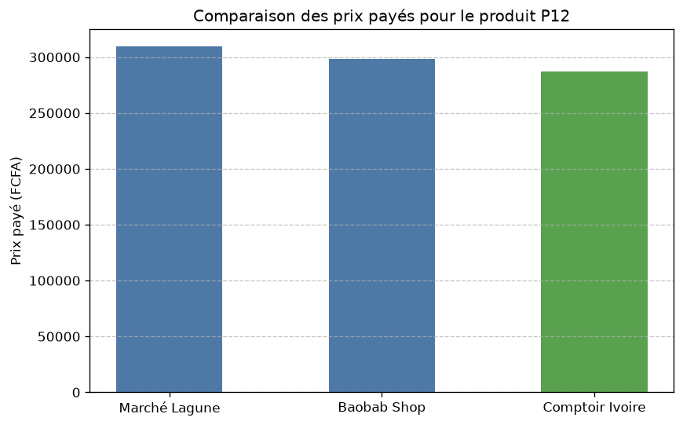
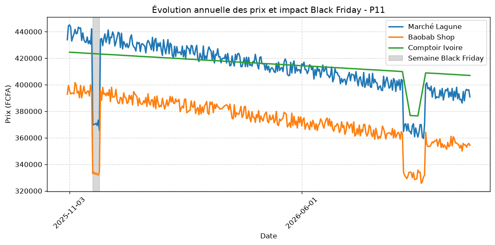

# Projet-2-ANALYSE-COMPARATIVE

Application décisionnelle d'analyse de marché · L2 Informatique, IIT Grand-Bassam · Kouadio Ketsia

Ce projet étudiant consiste à développer un programme en Python permettant d'automatiser l'analyse comparative des prix et des catalogues de trois boutiques en ligne.

Analyse comparative de prix : trois enseignes, un seul verdict

Programme Python qui répond à une question simple : **pour chaque produit, dans quelle enseigne l'acheter, et combien peut-on économiser ?**

Toutes les données sont **fictives** (exercice pédagogique). Les enseignes et les prix ne correspondent à aucun magasin réel.

> Un **pipeline** est une chaîne de traitements où chaque étape reçoit le résultat de la précédente : des données brutes entrent, des résultats exploitables sortent.

---

## 1. Contexte

Un client veut acheter de l'électronique et de l'électroménager à Abidjan et hésite entre trois enseignes. Chacune fournit ses données **dans un format différent** et **écrit les noms à sa façon** :

| Enseigne        | Fichier                     | Format           | Particularité                                                  |
| --------------- | --------------------------- | ---------------- | --------------------------------------------------------------- |
| Marché Lagune  | `marche_lagune.csv`       | CSV (`,`, BOM) | prix en texte (`102 900 FCFA`), livraison **incluse**   |
| Baobab Shop     | `baobab_shop.json`        | JSON             | titres en anglais, `amount` + `delivery_fee` à additionner |
| Comptoir Ivoire | `comptoir_ivoire.xlsx`    | Excel            | en-têtes en ligne 3, prix catalogue **moins une remise** |
| Référence     | `catalogue_reference.csv` | CSV              | 30 produits (P01 à P30)                                        |
| Historique      | `historique_prix.csv`     | CSV              | 20 876 prix quotidiens, du 01/11/2025 au 31/10/2026             |

## 2. Résultats clés

Sur **30 produits**, **23 sont comparables** (au moins deux enseignes avec un prix exploitable en stock). Les 7 autres sont listés avec leur raison dans le journal.

| Indicateur                                               | Marché Lagune                        | Baobab Shop    | Comptoir Ivoire |
| -------------------------------------------------------- | ------------------------------------- | -------------- | --------------- |
| Fois la moins chère (égalités comptées pour chacune) | 6                                     | 9              | 10              |
| Écart moyen au prix le plus bas                         | +3,79 % (18 produits)                 | +4,67 % (20)   | +2,81 % (18)    |
| Panier de rentrée                                       | incomplet (P04 sans prix exploitable) | 491 500 FCFA   | 484 075 FCFA    |
| Semaine du Black Friday vs moyenne annuelle              | −11,3 %                              | −11,7 %       | +3,8 %          |
| Mois le moins cher                                       | septembre 2026                        | septembre 2026 | septembre 2026  |

- **Panier optimal** (chaque article là où il est le moins cher) : **477 575 FCFA**, soit 6 500 FCFA de moins que la meilleure enseigne unique, au prix d'achats dans trois enseignes.
- **Plus gros gain en FCFA** : HP 250 G9 (P11), **52 800 FCFA (+14,9 %)**, meilleure offre chez Baobab. Viennent ensuite l'iPhone 13 (26 500) et le climatiseur LG 1 CV (26 000).
- **Plus gros gain en %** : bouilloire (+26,1 %), clé USB SanDisk (+19,7 %), congélateur Nasco (+16,0 %). Un fort pourcentage peut représenter une petite somme : la clé USB ne fait gagner que 1 200 FCFA.
- **Quand acheter ?** Lagune et Baobab font un vrai Black Friday (environ −11 %). Comptoir n'en fait pas : sa semaine du 24 au 30 novembre est plus chère que sa moyenne. Chez les trois, les prix baissent au fil de l'année et sont au plus bas en septembre 2026.

Deux graphiques sont générés dans `output/` : comparaison des prix du Lenovo IdeaPad 3 (P12) et évolution annuelle du HP 250 G9 (P11) avec la semaine du Black Friday en gris.




## 3. Installation et lancement

Prérequis : Python 3.10 ou plus récent.

```powershell
python -m venv .venv
.venv\Scripts\Activate.ps1        # Windows PowerShell
pip install -r requirements.txt   # openpyxl, matplotlib
python src/main.py
```

Le programme affiche le rapport de synthèse dans la console et écrit dans `output/` :

| Fichier                                         | Contenu                                                                  |
| ----------------------------------------------- | ------------------------------------------------------------------------ |
| `comparatif.csv`                              | une ligne par produit comparable (séparateur `;`, s'ouvre dans Excel) |
| `journal_nettoyage.txt`                       | toutes les anomalies détectées et le traitement appliqué              |
| `comparaison_P12.png`, `historique_P11.png` | graphiques                                                               |

Tests :

```powershell
python tests/test_cas_limites.py   # cas limites
python tests/stress.py             # montée en charge (500 produits par boutique)
```

## 4. Structure du dépôt

```
Projet-2-ANALYSE-COMPARATIVE/
├── data/                  données fournies (3 enseignes, catalogue, historique)
├── src/
│   ├── collecte.py        lit CSV / JSON / Excel vers un format commun
│   ├── nettoyage.py       prix, stock, doublons, noms normalisés + journal
│   ├── rapprochement.py   nom brut → produit_id, index, prix aberrants
│   ├── comparaison.py     meilleur prix, moyenne, écarts, export CSV
│   ├── synthese.py        victoires, écarts moyens, top 3
│   ├── panier.py          panier de rentrée (par enseigne et optimal)
│   ├── historique.py      Black Friday, mois le moins cher, mesure du temps
│   ├── graphiques.py      graphiques matplotlib
│   └── main.py            enchaîne tout le pipeline
├── tests/
│   ├── test_cas_limites.py
│   └── stress.py
├── output/                résultats générés
├── requirements.txt
└── README.md
```

Il n'y a ni MVC ni `__init__.py` : le projet est un **pipeline de données** sans interface, avec un module par étape.

## 5. Le pipeline

```
 3 fichiers          format           valeurs          produit_id          tableau
 CSV/JSON/XLSX ───►  commun    ───►   propres   ───►   du catalogue ───►   comparatif ───► synthèse, panier
   collecte        collecte.py      nettoyage.py      rapprochement.py     comparaison.py
                                                                     historique.py ───► Black Friday
```

1. **Collecte** : chaque fichier est lu une seule fois et traduit dans le même dictionnaire (`source`, `id_source`, `nom_brut`, `prix_brut`, `livraison`, `remise_pct`, `stock_brut`).
2. **Nettoyage** : prix texte converti en entier, prix réellement payé calculé selon l'enseigne, stock unifié en booléen, doublons supprimés avec un `set`, noms mis en minuscules, sans accents ni espaces superflus. Chaque anomalie est écrite dans le journal.
3. **Rapprochement** : chaque nom est découpé en mots-clés ; la ressemblance avec chaque produit du catalogue est mesurée par l'**indice de Jaccard**. Le meilleur score gagne s'il atteint 0,2 et dépasse le deuxième d'au moins 0,05. Les résultats sont rangés dans un dictionnaire `index[produit_id][enseigne]`.
4. **Prix aberrants** : un prix supérieur à 3 fois ou inférieur à un tiers de la **médiane** (si au moins 3 prix existent) est écarté et journalisé. C'est le cas du Tecno Spark 20 chez Lagune (779 000 FCFA contre une médiane de 76 300).
5. **Comparaison, synthèse, panier** : calculs sur l'index, sans relire les fichiers.
6. **Historique** : lu une seule fois et indexé par `(enseigne, produit)`.

## 6. Complexité

N = nombre de lignes lues, P = nombre de produits, M = taille du catalogue, S = nombre d'enseignes (constant), A = articles du panier.

| Phase          | Temps      | Mémoire | Pourquoi                                               |
| -------------- | ---------- | -------- | ------------------------------------------------------ |
| Collecte       | O(N)       | O(N)     | une seule lecture par fichier                          |
| Nettoyage      | O(N)       | O(N)     | un passage ; `set` pour les doublons (test en O(1))  |
| Rapprochement  | O(N × M)  | O(P)     | chaque ligne est comparée aux M produits du catalogue |
| Prix aberrants | O(P)       | O(1)     | médiane sur au plus 3 prix par produit                |
| Comparaison    | O(P)       | O(P)     | S constant                                             |
| Synthèse      | O(P log P) | O(P)     | tri pour les classements                               |
| Panier         | O(A × S)  | O(1)     | accès par dictionnaire                                |
| Historique     | O(N)       | O(N)     | indexation pendant l'unique lecture                    |

Aucune boucle imbriquée sur les données, donc pas de complexité quadratique ni exponentielle : le programme ne teste jamais « toutes les combinaisons ».

**Mesures** (historique de 20 876 lignes, 78 couples enseigne-produit ; indicatives, elles varient selon la machine) :

| Étape                                                                                        | Temps    |
| --------------------------------------------------------------------------------------------- | -------- |
| Lecture + indexation de l'historique                                                          | ≈ 25 ms |
| Analyse avec l'index (Black Friday + mois)                                                    | ≈ 15 ms |
| Même analyse en refiltrant toutes les lignes pour chaque couple (approche naïve, O(K × N)) | ≈ 70 ms |

**Montée en charge** (`tests/stress.py`, 500 produits par boutique, noms synthétiques) : le rapprochement par **index inversé** (mot → produits qui le contiennent) est plusieurs dizaines de fois plus rapide que la comparaison à tout le catalogue. Le temps de l'approche naïve y est **extrapolé** à partir d'un échantillon de 50 lignes. Dans le pipeline livré, M = 30 : le parcours du catalogue suffit. L'index inversé est la voie d'optimisation si le catalogue grossit.

## 8. Tests

`tests/test_cas_limites.py` vérifie les cas pièges : prix texte avec espace insécable, prix absents, noms avec espaces et accents, stock (`Rupture`, `0`), fautes de frappe (`Samsun`), distinction `A15` / `A25`, produit exclusif, égalité entre enseignes, prix aberrant et panier incomplet.

## 9. Limites et pistes

- Le dictionnaire de synonymes est écrit à la main : il faudrait l'enrichir pour un nouveau catalogue.
- Le rapprochement peut échouer sur des noms très atypiques ; ces lignes sont alors journalisées (`produit non rapproché`) plutôt qu'associées au hasard.
- Les frais de livraison par commande ne sont pas modélisés.
- Pistes : alerte automatique quand un prix baisse, comparaison des semaines voisines du Black Friday, interface web.
